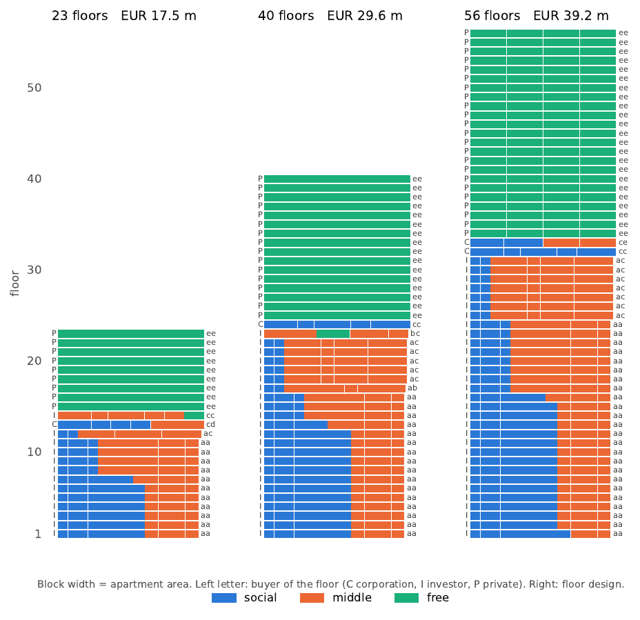

# Optimal Design of a Residential Tower (MILP)

A mixed-integer linear programming model that designs a residential tower for maximum
developer profit under Dutch-style housing regulations, solved for towers of
**23, 40 and 56 floors**.

Course assignment, University of Amsterdam (2026).

## The problem

A developer builds a tower with a fixed number of floors. For every floor it chooses one of
11 pre-defined floor designs (each a combination of two floor parts with given apartment
sizes, 36–131 m²). Every apartment is then assigned to

- a **sector**: social, middle or free (market) housing, and
- a **buyer**: a housing corporation, an investor or a private buyer.

The profit of an apartment depends on its size, sector, buyer and the height of the tower.
The design must satisfy twelve restrictions, including:

- at least 40% social and at least 40% middle-segment apartments;
- minimum average sizes for social (40 m²) and middle (50 m²) apartments;
- minimum sizes per sector and buyer, and no free-sector apartments for corporations;
- at least 70% of all apartments sold to investors;
- one buyer per floor, and no social and free apartments on the same floor;
- floors ordered from the ground up by their smallest apartment.

## Approach

Modelling the tower floor by floor needs thousands of variables and is very hard to solve.
This model uses two observations instead:

1. **Floor numbers are not needed.** The ordering rule only fixes the *order* of the floors,
   so the model decides *how many* floors of each type to build and sorts them afterwards.
2. **Floors of the same type are interchangeable.** A floor type is defined by its design,
   its buyer and its *mode* (social + middle, or middle + free), which enforces the
   one-buyer-per-floor and social/free rules by construction.

The result is a model with **143 integer variables and 56 constraints, independent of the
number of floors**, solved to proven optimality in about one second with the open-source
CBC solver. The full formulation and a proof that it is equivalent to the floor-by-floor
problem are in Appendix A of the report.

Every solution is converted back into an explicit apartment-by-apartment floor plan on which
all twelve restrictions are checked. As an independent check, a floor-by-floor model
(1 932 variables for 23 floors) solved with CBC and HiGHS reached the same optimum.

## Results

|                           | 23 floors | 40 floors | 56 floors |
|---------------------------|----------:|----------:|----------:|
| Maximum profit            | €17.48 m  | €29.62 m  | €39.19 m  |
| Profit per floor          | €760 k    | €741 k    | €700 k    |
| Apartments                | 193       | 334       | 464       |
| Social / middle / free    | 78 / 78 / 37 | 134 / 134 / 66 | 186 / 186 / 92 |

All three optimal towers follow the same pattern: private free-sector penthouses at the top
earn almost all the profit, while many small investor apartments at the bottom raise the
total number of apartments and thereby the 20% ceiling on free housing. A sensitivity
analysis shows that the 40% sector quotas cost about one third of the profit each, while
six of the twelve restrictions cost nothing.



## Repository contents

| Path | Description |
|---|---|
| `housing_model.ipynb` | Full implementation: model, solution of the three cases, verification, sensitivity analysis, figures and an optional cross-check |
| `report/Housing_report.pdf` | Report for the developer (4 pages + appendices with the model and floor plans) |
| `report/report.tex` | LaTeX source of the report, with its figures and floor-plan tables |
| `requirements.txt` | Python dependencies |

## Running the notebook

```bash
pip install -r requirements.txt
jupyter notebook housing_model.ipynb
```

**The input data is not included**, because it was provided as course material. The notebook
expects an Excel workbook `Housing_Problem_-_parameter_values.xlsx` in the same folder with:

- a sheet `number_of_apartments` with columns `area`, `configuration`, `no_of_apartments`
  (apartments of each area per floor design);
- one sheet per tower height named `profit_height_<metres>` (e.g. `profit_height_69`) with
  columns `sector`, `area`, `owner`, `profit`. The number of floors is the height divided by 3.

The executed notebook in this repository already shows all outputs.

Switches at the top of the notebook control the optional parts: `RUN_SENSITIVITY`
(about 30 seconds) and `RUN_CROSSCHECK` (off by default; up to 30 minutes per case).
